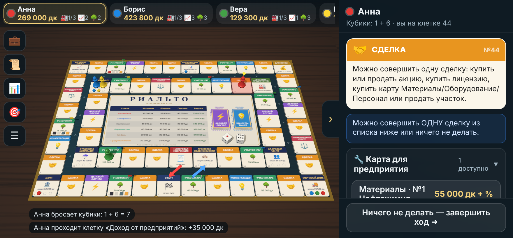

# Риальто — экономическая настольная игра для Android


Оригинальная экономическая настольная игра на 2–6 игроков с объёмным 3D-полем.
Покупайте земельные участки, собирайте на них предприятия (лицензия + материалы + оборудование + персонал),
вкладывайтесь в акционерные компании, торгуйтесь на аукционах, берите кредиты и займы под вексель.
Побеждает тот, у кого в конце окажется самый большой капитал.



## Установка

1. Скачайте APK по прямой ссылке: **[⬇ Rialto.apk](https://github.com/lokofanmoscow-rgb/Rialto/releases/latest/download/Rialto.apk)**
   (или откройте раздел [Releases](https://github.com/lokofanmoscow-rgb/Rialto/releases) и нажмите `Rialto.apk` в блоке *Assets*).
   Файл `apk/Rialto.apk` в самом репозитории GitHub показывает как набор символов — его качать не нужно.
2. Откройте скачанный файл на телефоне и разрешите установку из неизвестных источников.
3. Нужен Android 7.0 или новее с обновлённым Android System WebView (требуется WebGL 2).

## Режимы игры

| Режим | Как начать |
|---|---|
| **На одном устройстве** | «Играть на одном устройстве»: 2–6 игроков ходят по очереди и передают телефон. Любого игрока можно сделать компьютером 🤖. |
| **С компьютером** | «Играть с компьютером»: вы и два компьютерных соперника. |
| **По Wi-Fi** | Один игрок нажимает «Создать игру по Wi-Fi», остальные — «Присоединиться по Wi-Fi». Игра сама появится в списке. Если её нет, введите адрес, который показан у хоста. Хост может добавить игроков на своём устройстве и компьютерных соперников. |

* Все устройства должны быть в одной сети Wi-Fi. Подойдёт и точка доступа на телефоне одного из игроков.
* Если игрок отключился, после повторного входа он автоматически вернётся на своё место. Хост может доиграть за отключившегося.
* Используются порты: TCP 47321 (игра) и UDP 47322–47323 (поиск игр).

### Сохранения

* «Меню → Сохранить игру»: 6 слотов. Кроме того, каждый ход игра сохраняется в слот «Автосохранение».
* «Загрузить игру»: продолжить на этом устройстве или открыть сохранение как сетевую игру (хостом).

## Управление

* Один палец вращает поле, двумя пальцами масштаб и сдвиг, касание клетки показывает её описание и владельца.
* 🎯 возвращает камеру. Правая панель всегда показывает, **кто сейчас действует и что можно сделать**: доступные кнопки,
  цены и причину, по которой действие недоступно. Панель сворачивается стрелкой.
* 💼 Портфель: деньги, акции, участки и ход строительства, кредиты, векселя, займы.
* 📜 Журнал всех событий, 📊 таблица цен и акционеров, ☰ меню (сохранение, правила, звук).

## Коротко о правилах

Полные правила есть в игре: «Правила».

* Старт: 300 000 дк (дукатов) и 3 векселя. Фишки идут по внешнему кругу. С клетки 35 по синей стрелке они поднимаются
  на внутренний круг, а через Налоговую инспекцию (налог 10%) по красной стрелке возвращаются на Старт.
* **Предприятие** строится на своём участке: лицензия → материалы, оборудование, персонал. После ввода банк платит
  выручку отрасли и половину цены участка. Цель по умолчанию — 3 предприятия.
* **8 акционерных компаний** (Банк, Фондовая биржа, Торговый дом, Кадровый центр, Агентство недвижимости, Консалтинговая
  компания, Бизнес-школа, Страховая компания), у каждой по 3 акции. Доход компании делится между акционерами. Если вы не
  контролируете Торговый дом или Кадровый центр, их акционеры назначают вам комиссионные.
* Клетки: Сделка, Участок, Деловой случай (страховка покрывает убытки), Консультация, Антимонопольный комитет,
  Дивиденды, Доход от предприятий, Банк (проценты по кредитам).
* Продажа акций и участков проходит через аукцион. Если не хватает денег на платёж, наступает финансовая необеспеченность:
  нужно продать имущество или занять у игрока, иначе банкротство.

## Сборка из исходников

```bash
# Нужны: Node.js 18+, JDK 17+, Android SDK с platforms;android-34 и build-tools;35.0.0
export ANDROID_HOME=/путь/к/android-sdk
./build_apk.sh          # результат: apk/Rialto.apk
```

Скрипт обходится без Gradle. Он собирает веб-часть (esbuild), упаковывает её в assets, компилирует Java (javac + d8) и
подписывает APK ключом `android/rialto-release.keystore`. Подпись у всех сборок одна, поэтому новые версии ставятся
поверх старых. При каждом push GitHub Actions собирает APK и публикует его как новый релиз (`.github/workflows/build-apk.yml`).

### Тесты

```bash
cd web
npm install
node test/rules.test.mjs     # точечные проверки правил
node test/engine.test.mjs    # 300 случайных партий с проверкой инвариантов
```

Сетевую игру можно отлаживать в браузере. Запустите `node tools/devrelay.mjs` и откройте
`web/dist/index.html?devnet=ws://localhost:8787` в нескольких вкладках.

## Устройство проекта

```
web/                       игра (HTML + JS, Three.js)
  src/engine/data.js       поле, компании, отрасли, карты — все числа игры
  src/engine/engine.js     правила: состояние игры и обработка действий
  src/engine/bot.js        компьютерный соперник
  src/scene/               3D-поле: текстура, плитки, фишки, кубики, камера
  src/ui/                  интерфейс: панель действий, окна, меню
  src/game/session.js      игра на одном устройстве, хост и клиент сети
  src/net/bridge.js        мост к сетевому коду Android (или ретранслятор для отладки)
android/                   Android-приложение (WebView)
  src/.../MainActivity.java   окно с WebView
  src/.../LanNet.java         TCP-сервер/клиент и UDP-поиск игр (чистая Java)
  src/.../NetBridge.java      JS-мост к LanNet
  src/.../StoreBridge.java    слоты сохранений в памяти приложения
build_apk.sh               сборка APK
apk/Rialto.apk             готовый APK
```
